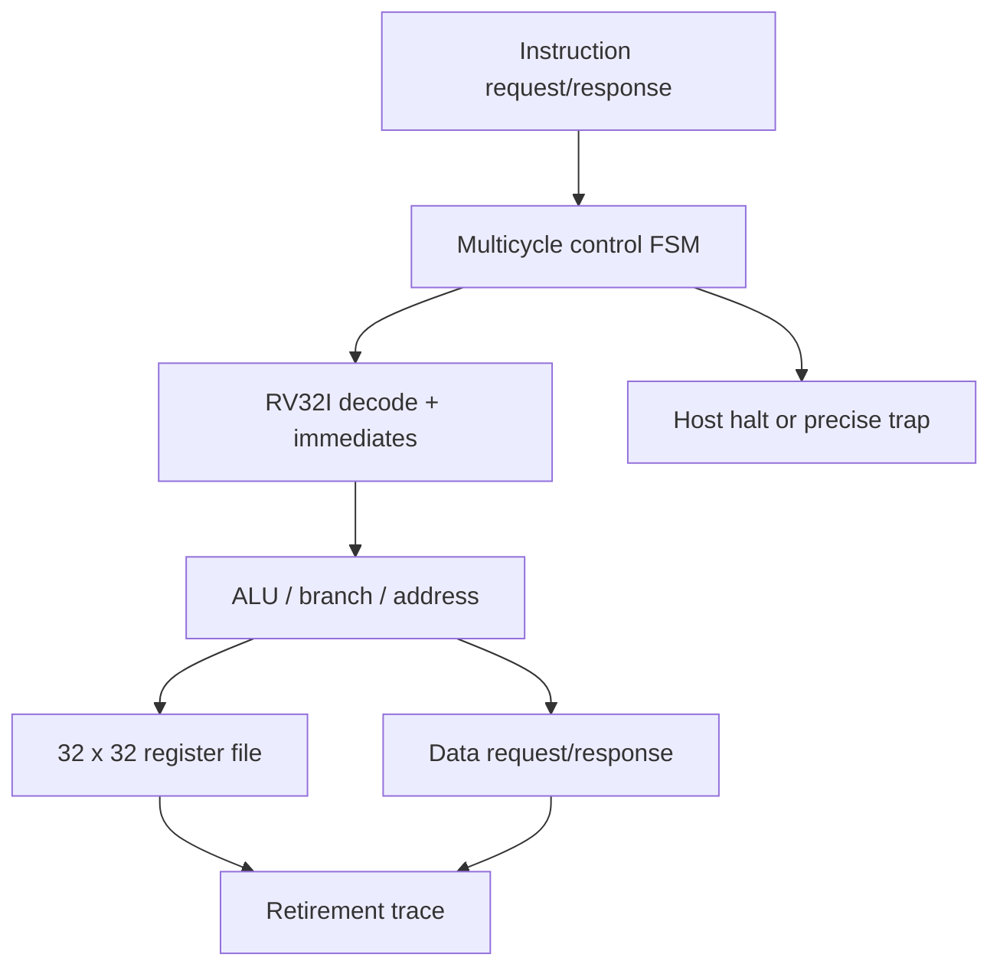
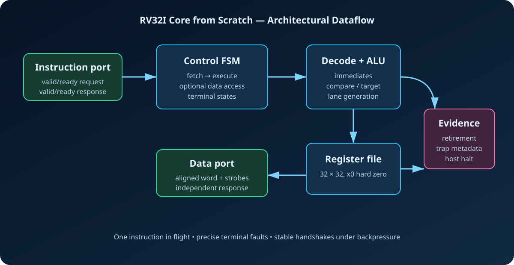
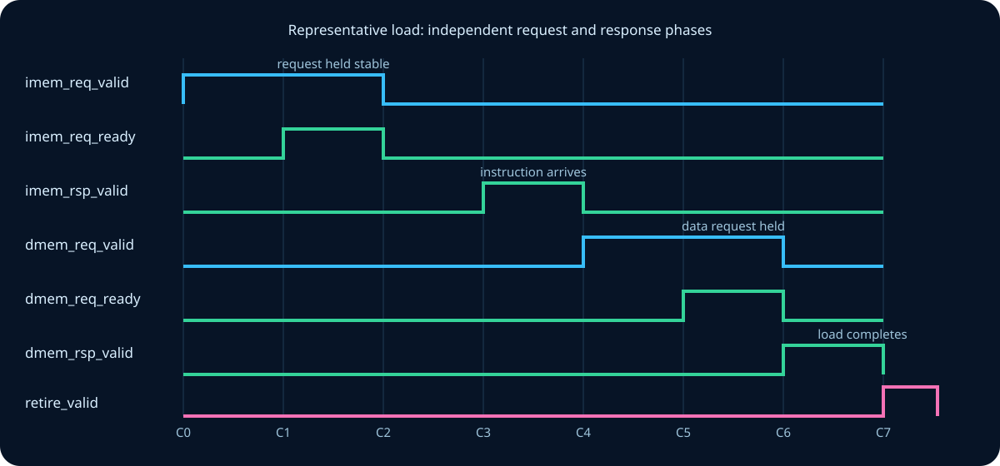

# RV32I Core from Scratch

[](https://github.com/ashishkommineni/rv32i-core-from-scratch/actions/workflows/rtl-regression.yml)

A small, original SystemVerilog RV32I core built from first principles and
verified at the instruction, bus, trap, assertion, and UVM levels. The design
uses a deliberately transparent multicycle microarchitecture: one instruction
fetch, one execute step, and—when needed—one data transaction are completed
before the next instruction begins.

This repository answers a concrete engineering question:

> Can a readable teaching core execute every RV32I base integer operation,
> tolerate bus backpressure, report precise terminal faults, and prove its
> architectural results against an independent reference model?

## Architecture





The request and response channels are independent valid/ready handshakes. A
request remains stable while stalled, and the core accepts a response only in
the corresponding response state. This makes variable memory latency part of
the normal design, not a special test mode.

## Implemented instruction set

| Group | Instructions |
|---|---|
| Upper immediate | `LUI`, `AUIPC` |
| Control flow | `JAL`, `JALR`, `BEQ`, `BNE`, `BLT`, `BGE`, `BLTU`, `BGEU` |
| Loads | `LB`, `LH`, `LW`, `LBU`, `LHU` |
| Stores | `SB`, `SH`, `SW` |
| Immediate ALU | `ADDI`, `SLTI`, `SLTIU`, `XORI`, `ORI`, `ANDI`, `SLLI`, `SRLI`, `SRAI` |
| Register ALU | `ADD`, `SUB`, `SLL`, `SLT`, `SLTU`, `XOR`, `SRL`, `SRA`, `OR`, `AND` |
| Ordering/system | base `FENCE`, `ECALL`, `EBREAK` |

`FENCE` retires as a no-op because this in-order core permits only one bus
transaction at a time. `ECALL` enters the terminal trap state with machine-mode
cause 11. `EBREAK` is intentionally used as a **simulation host-halt convention**:
it enters `ST_HALT`, exposes breakpoint metadata, and does not assert
`trap_valid`. That convention is documented rather than presented as a complete
privileged architecture.

## Cycle flow

| State | Action | Exit condition |
|---|---|---|
| `ST_FETCH_REQ` | Present aligned PC on instruction request | request handshake |
| `ST_FETCH_RSP` | Wait without issuing a duplicate request | response handshake |
| `ST_EXECUTE` | Decode, compute, branch, retire, or launch data access | one clock |
| `ST_DMEM_REQ` | Hold address/data/strobes stable | request handshake |
| `ST_DMEM_RSP` | Wait for load/store completion | response handshake |
| `ST_HALT` | Verification terminal state for `EBREAK` | reset |
| `ST_TRAP` | Precise terminal fault metadata | reset |



An ALU instruction normally requires fetch-request, fetch-response, and execute
phases. A load or store adds data-request and data-response phases. Any amount of
ready/valid backpressure can extend the corresponding phase without changing
the request payload.

## Precise terminal traps

The core reports `trap_cause`, `trap_pc`, and `trap_value` for:

| Cause | Condition | `trap_value` |
|---:|---|---|
| 0 | instruction target misaligned | bad target |
| 1 | instruction response error | faulting PC |
| 2 | illegal instruction | instruction word |
| 4 | load address misaligned | effective address |
| 5 | load response error | effective address |
| 6 | store address misaligned | effective address |
| 7 | store response error | effective address |
| 11 | environment call from M-mode | zero |

These are terminal teaching traps: the repository does not claim CSRs,
`mtvec`, delegation, or `MRET`.

## Verification architecture

The verification is intentionally layered:

1. `tools/rv32i_asm.py` encodes the directed program without an external
   toolchain.
2. `tools/rv32i_ref.py` independently executes the program and creates the
   expected memory signature.
3. `tests/test_reference.py` checks known encodings, immediate limits, all
   generated terminal tests, and the full signature.
4. `dv/tb/rv32i_core_tb.sv` adds randomized deterministic wait states,
   self-checking signature comparison, eight trap tests, and portable coverage
   gates for every implemented instruction family.
5. `dv/sva/rv32i_core_sva.sv` checks stable stalled requests, aligned bus
   addresses, legal strobes, x0 integrity, and terminal-state behavior.
6. `dv/uvm/` provides active instruction/data memory agents, monitors, a
   retirement-driven architectural scoreboard, constrained response latency,
   functional coverage, smoke and trap tests, and an Xcelium-ready top.

The UVM memory responder is program-driven: the core itself initiates bus
traffic, while the agents randomize latency and return memory responses. The
scoreboard reconstructs architectural state from completed fetch/data
transactions and compares every retirement. This is more accurate than calling
the terminal wait sequence a stimulus generator.

## Run the verified portable flow

Requirements: Python 3, GNU Make, Verilator 5 or later, and the pinned CI parser
dependency installed with `python3 -m pip install -r requirements-ci.txt`.

```bash
make check      # regenerate vectors, run reference tests, inspect structure
make uvm-syntax # parse every UVM source unit (syntax only)
make lint       # SystemVerilog lint plus SVA elaboration
make regress    # reference checks, ISA smoke test, and eight trap simulations
make waves      # smoke test with results/rv32i_core.vcd
```

The expected successful endings are documented in
[`results/expected_output.txt`](results/expected_output.txt). The smoke test must
print `TEST_PASS name=smoke`; each directed fault must print its own `TEST_PASS`
with the expected cause. A GitHub Actions job runs the same portable regression
plus a pinned `pyslang` UVM syntax gate on every push and pull request. The
syntax gate does not replace Xcelium elaboration or execution.

For Cadence Xcelium with UVM 1.2:

```bash
make xcelium-smoke
make xcelium-traps
```

These targets are prepared for an installation with `xrun` on `PATH`. **No
Xcelium pass or coverage percentage is claimed unless an actual transcript and
IMC report are preserved.** The portable Python checks can run in this workspace;
simulator-dependent claims are recorded separately in
[`docs/verification_report.md`](docs/verification_report.md).

## Repository map

```text
rtl/          synthesizable package and multicycle RV32I core
dv/tb/        portable self-checking testbench
dv/sva/       protocol and architectural assertions
dv/coverage/  UVM functional coverage model
dv/uvm/       agents, interfaces, sequences, scoreboard, tests and top
dv/programs/  generated smoke signature and eight directed trap images
tools/        dependency-free assembler helpers and reference interpreter
scripts/      deterministic vector and structure generators/checkers
tests/        executable reference-model unit tests
docs/         specification, architecture, verification and interview notes
assets/       version-controlled architecture and timing diagrams
results/      expected-output contract; generated waveforms are ignored
```

## Engineering boundaries

This is a portfolio-quality educational core, not a Linux-capable CPU or an
ISA-certified implementation.

- RV32I only: no multiply/divide, atomics, compressed instructions, floating
  point, caches, MMU, debug module, interrupts, or privileged CSR file.
- The interfaces use a project-specific valid/ready contract, not AXI or AHB.
- The design is multicycle and prioritizes observability over throughput.
- `EBREAK` is a test-host stop convention; production exception handling would
  route it through architectural trap CSRs.
- Functional simulation does not replace synthesis, STA, CDC/RDC, formal, DFT,
  power, or physical-design sign-off.
- The directed program is broad and self-checking, but the repository does not
  claim official RISC-V architectural-test certification.

## Interview-ready explanation

> “I implemented an RV32I core from scratch as a simple multicycle machine. The
> instruction and data ports use separate request/response handshakes, so the
> control FSM naturally holds payloads through backpressure. Decode computes all
> RV32I immediates, checks IALIGN=32 control targets and load/store alignment,
> and emits a retirement trace. I verify it with an independent Python reference
> interpreter, a self-checking Verilator regression covering every instruction
> family and eight terminal fault cases, SVA for bus invariants, and a UVM
> retirement scoreboard prepared for Xcelium. I explicitly treat EBREAK as a
> host-halt convention and do not claim privileged ISA support.”

See [`docs/interview_guide.md`](docs/interview_guide.md) for design questions and
follow-ups that can be answered directly from the implementation.

## License and provenance

The RTL, tests, documentation, and diagrams in this repository are original
educational work and are released under the MIT License. No third-party CPU RTL
is copied into this implementation. RISC-V is used as the ISA name; this project
is not endorsed or certified by RISC-V International.

